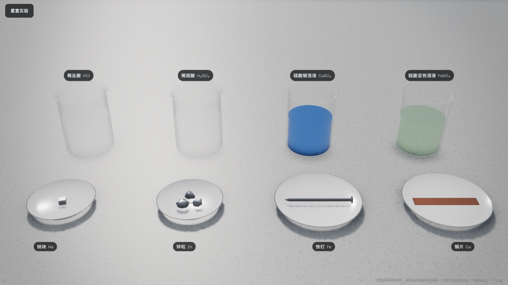
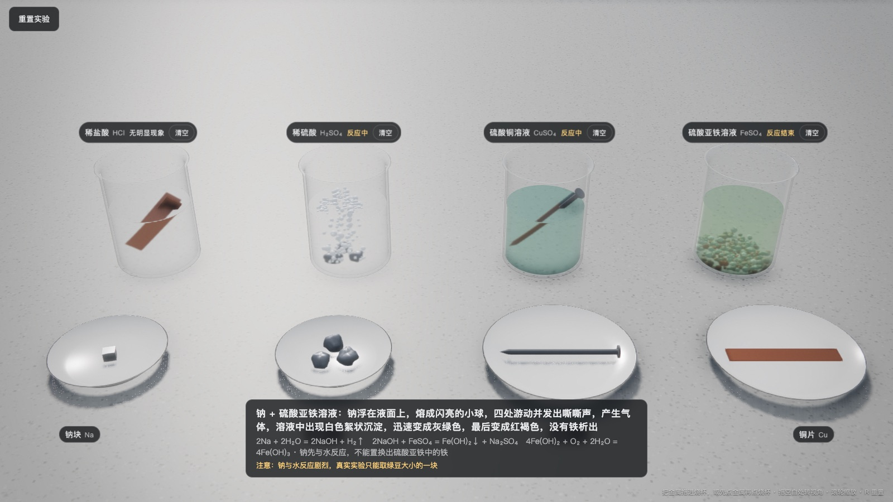
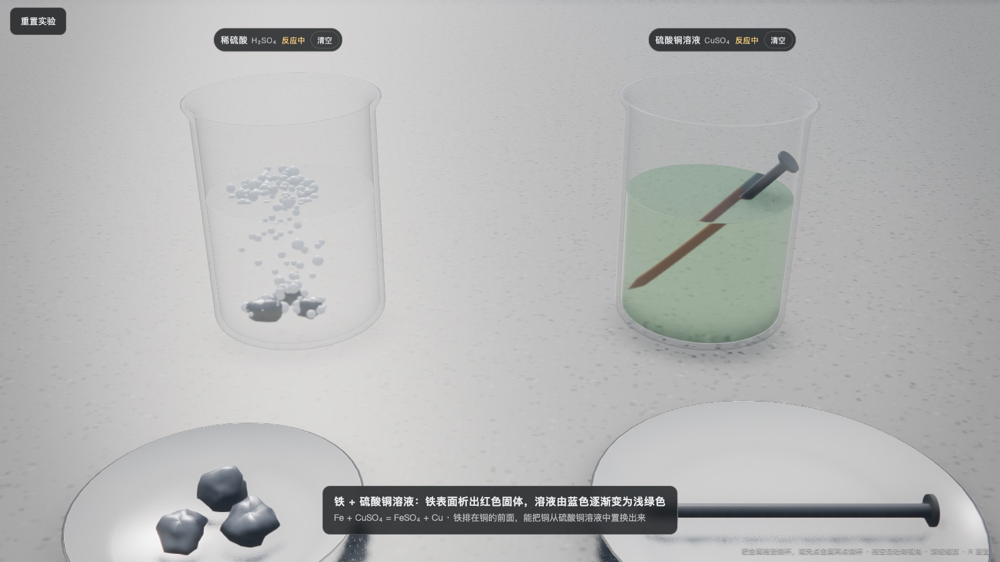
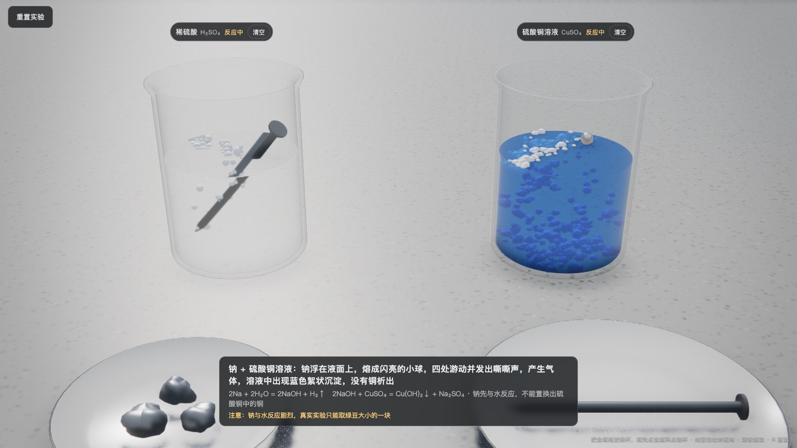
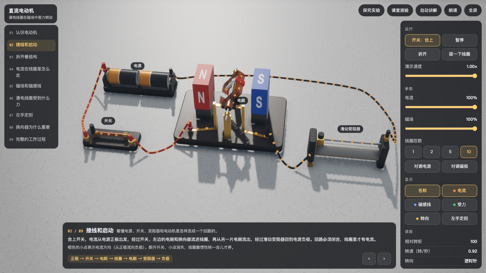
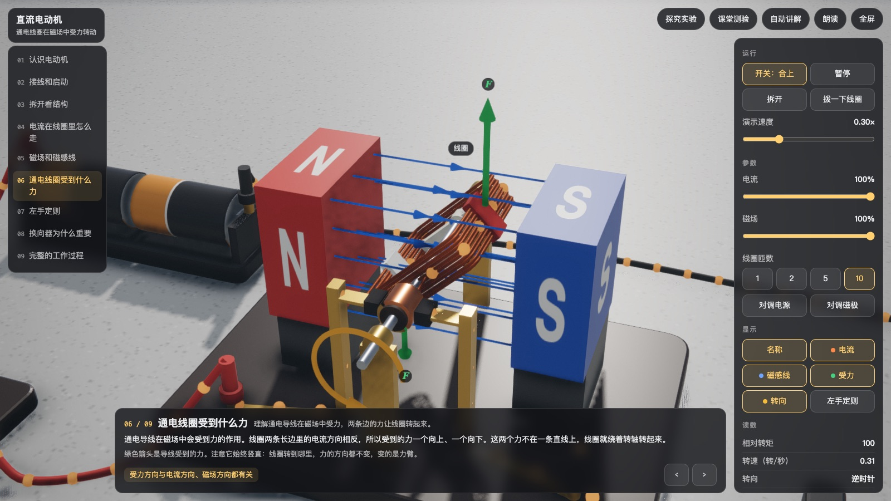
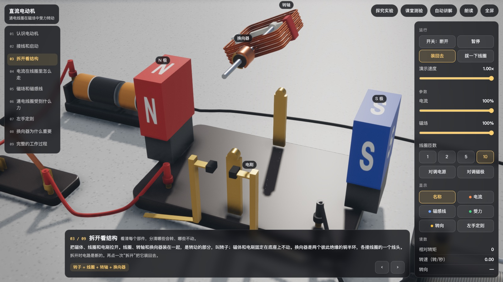
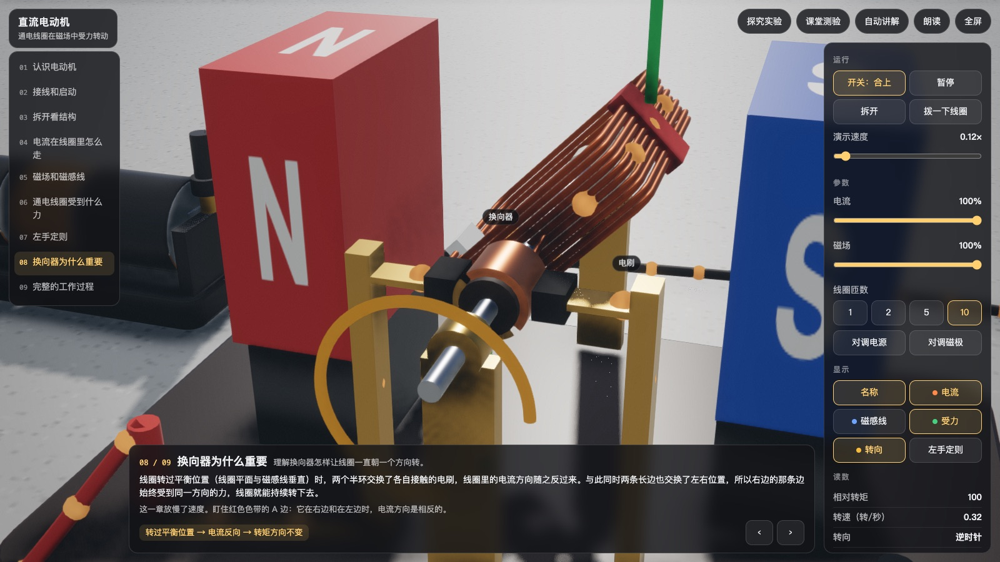

# lab-bench

一张可以动手的 3D 实验桌，用 three.js 渲染，给课堂演示和学生自己试用。
把东西放进试剂里看会发生什么，比老师讲半天直观。

桌上现在有两个实验。实验的结论都由不依赖渲染、带测试的规则模块给出，画面只负责把现象演出来。

**金属活动性**（`experiments/metal-activity/`，成品 `dist/metal-activity.html`）：四个烧杯、四种金属，把金属拖进烧杯看现象。






**直流电动机**（`experiments/dc-motor/`，成品 `dist/dc-motor.html`）：一台结构外露的教学电动机，和电池、开关、滑动变阻器接成回路。点开关、点磁体、点接线柱，改电流、磁场和匝数；九章讲解、六个探究实验、八道测验。






这份文档写给接手的人（或 agent）：先讲怎么跑、代码怎么分层，再讲怎么加金属、加试剂、加现象、加一个全新的实验。

## 运行

```bash
npm install
npm run dev          # 金属活动性：改代码自动重建并起本地服务，地址打印在终端
npm run dev:motor    # 直流电动机
npm run build        # 生成 dist/ 下的两个单文件页面，双击即可打开
npm test             # 规则模块的测试，不需要浏览器
```

仓库里的 `dist/*.html` 是构建好的成品，下载后直接双击就能用。

下面“操作”和“网址参数”两节说的是金属活动性；电动机的见后面“直流电动机”一节。

操作：

- 把金属拖进烧杯；或者先点金属（它会抬起来），再点烧杯。
- 烧杯里有金属后，标签上出现“清空”，换一杯新溶液。左上角“重置实验”清空全部，键盘 `R` 同效。
- 在桌面空白处拖动可以小幅转动视角，滚轮或双指捏合拉近拉远。拉近时以指针所指的位置为中心。
- 右上角“画面”面板：反应速度、画质、液体是否折射、调试视图。

网址参数：

| 参数 | 作用 |
|---|---|
| `put=Fe:CuSO4,Na:FeSO4` | 开场就把这些金属放进对应试剂 |
| `t=12` | 开场先快进 12 秒 |
| `still=1` | 冻结时间、去掉淡入淡出，用于截图（配合 `put` 和 `t`） |
| `speed=4` | 反应速度倍数 |
| `zoom=0.5` `pitch=0.42` `yaw=0.2` | 初始视角 |
| `liquid=simple` | 液体不做折射（省一遍场景渲染，给弱显卡） |
| `q=low` | 画质档：low / medium / high / ultra |
| `gui=0` `hud=0` | 隐藏面板 / 隐藏全部界面 |

## 代码分层

```
engine/                      渲染管线（天空、软阴影、体积光、后期、调色），来自作者的 cine-engine
bench/                       实验桌：与具体实验无关的部分
experiments/metal-activity/  第一个实验：金属活动性
scripts/build.mjs            把一个实验打包成单文件 HTML
```

一个实验内部分三步：

```
chem/judge.js  ──►  outcome  ──►  reaction.js  ──►  画面
（判断）             （数据）        （演出）
```

关键的约定只有一条：**规则引擎只产出数据，演出层只读 `outcome.phenomena`**。
`main.js` 和 `reaction.js` 里没有任何“如果是铁和硫酸铜就……”这样的分支。

`bench/`（换一个实验也照用）：

| 文件 | 职责 |
|---|---|
| `look.js` | 桌面尺度的光照预设；`cm()` 单位换算 |
| `room.js` | 桌面，以及一间只用来打光、永远不入镜的房间；`LIT` 是相机可以看到的范围 |
| `camera.js` | 相机：小幅转动、缩放，保证画面里只有桌面 |
| `environment.js` | 把房间烘成环境贴图，玻璃反射的是真实的窗户 |
| `glassware.js` | 烧杯、液体、盛固体的瓷盘 |
| `effects.js` | 气泡、沉淀絮状物（都是一次绘制的实例化网格）、会长镀层的金属材质 |
| `interaction.js` | 拖放、点选、视角与缩放。不认识任何学科内容，通过回调问宿主 |

`experiments/metal-activity/`：

| 文件 | 职责 |
|---|---|
| `chem/data.js` | 物质数据：活动性顺序、金属、阴离子、试剂、氢氧化物、颜色名。纯数据 |
| `chem/formula.js` | 由离子电荷生成化学式和配平的方程式 |
| `chem/judge.js` | `judge(金属, 试剂)`：按老师讲题的步骤判断，返回 outcome |
| `chem/judge.test.js` | 16 格的预期结果（手写）、配平校验、讲稿例题的逐步核对 |
| `chem/matrix.mjs` | 把全部组合打印成表格，给老师核对 |
| `reaction.js` | 把一个 outcome 在一个烧杯里演出来；溶液颜色表 `SOLUTION` 也在这里 |
| `solids.js` | 四种金属的实物模型，以及它们在烧杯里的姿态（斜靠 / 沉底 / 漂浮） |
| `main.js` | 台面布置、标签和字幕、主循环 |
| `index.html` | 页面外壳和样式 |

### outcome 的结构

```js
judge('Fe', 'CuSO4')
// {
//   metal: 'Fe', reagent: 'CuSO4',
//   family: 'metal-salt',            // 或 'metal-acid'
//   kind: 'salt-displacement',       // no-reaction | acid-displacement | salt-displacement | water-first | out-of-scope
//   reacts: true,                    // null 表示这条规则不适用（氧化性酸）
//   displaces: true,                 // 盐里的金属有没有被置换出来
//   compare: { left: 'Fe', right: 'Cu', relation: 'before' },   // 给顺序表高亮用
//   steps: [                         // 老师的判断步骤，status: pass | fail | skipped
//     { id: 'special-metal',     title: '核对金属是不是钾、钙、钠', status: 'pass', text: '铁不属于钾、钙、钠' },
//     { id: 'salt-soluble',      title: '核对盐是否可溶于水',       status: 'pass', text: '硫酸铜可溶于水' },
//     { id: 'position-vs-metal', title: '比较两种金属的位置',       status: 'pass', text: '铁排在铜的前面，活动性比铜强' },
//   ],
//   equations: [{ label: '置换出铜', plain: 'Fe + CuSO4 = FeSO4 + Cu', text: 'Fe + CuSO₄ = FeSO₄ + Cu' }],
//   phenomena: [                     // 给演出层的结构化现象
//     { type: 'deposit', on: 'metal', substance: 'Cu', color: 'red' },
//     { type: 'solutionColor', from: 'blue', to: 'paleGreen' },
//   ],
//   observations: ['铁表面析出红色固体', '溶液由蓝色逐渐变为浅绿色'],   // 考试表述
//   conclusion: '铁排在铜的前面，能把铜从硫酸铜溶液中置换出来',
//   caution: null,                   // 安全提示（钠）
//   pitfall: '铁在置换反应中生成 +2 价的亚铁盐……',                    // 易错点
// }
```

目前界面只用了 `phenomena`、`observations`、`equations`、`conclusion`、`caution`。
`steps`、`compare`、`pitfall` 是给还没做的教学界面（判断卡、顺序表）准备的，数据已经齐了。

### 现象词汇表

`reaction.js` 认识这些 `type`：

| type | 参数 | 演法 |
|---|---|---|
| `none` | — | 什么都不发生；3 秒后烧杯标签显示“无明显现象” |
| `gas` | `vigor`: slow / steady / violent | 金属表面冒泡上浮，速率由 vigor 决定 |
| `dissolve` | — | 金属慢慢变小 |
| `solutionColor` | `from`, `to`（颜色键） | 溶液在约 22 秒内渐变 |
| `deposit` | `color`（red / darkGrey） | 只有液面以下的金属表面长出一层镀层 |
| `floatAndDart` | — | 金属熔成亮球在液面乱窜，越来越小直到消失 |
| `precipitate` | `color`, 可选 `ages: { via, to }` | 絮状物从亮球经过的地方落下、堆在杯底，可随时间变色 |

## 直流电动机

它不是“往容器里放东西”的实验，但分层是一样的：

```
physics/motor.js  ──►  方向、转矩、转子运动  ──►  apparatus.js / overlays.js  ──►  画面
（规则）                 （数据）                    （器材和教学图层）
```

| 文件 | 职责 |
|---|---|
| `physics/motor.js` | 单线圈直流电动机：F = IL × B、换向器、转矩、转子的运动、状态描述。纯函数，可在 node 里跑 |
| `physics/motor.test.js` | 左手定则、换向、四种对调组合、正比关系、断电滑行、平衡位置、原页面六个实验的结论 |
| `content.js` | 九章讲解、六个探究实验、八道测验。纯数据 |
| `apparatus.js` | 器材模型：电动机（磁体、线圈、换向器、电刷）、电池盒、闸刀开关、滑动变阻器、带插头的导线 |
| `overlays.js` | 教学图层：电流小点、磁感线、受力箭头、转向、左手定则的三个方向 |
| `ui.js` | 章节列表、控制面板、字幕、实验和测验弹窗 |
| `main.js` | 把上面这些接起来：状态、动画、相机、主循环 |

坐标约定在 `physics/motor.js` 开头：转轴是 z 轴、朝向观察者，磁体在左右两侧（磁场沿 x），y 向上。物理模块和 3D 用同一套坐标，角度和力可以直接拿来用。

操作：点开关通断；点磁体对调磁极（磁体会抬起来转半圈）；点电动机的接线柱对调两根导线；点线圈拨它一下。右侧面板调电流（变阻器滑片跟着动）、磁场（磁体拉开或靠近）、匝数。键盘 `←` `→` 翻章，空格暂停，`H` 隐藏界面。

网址参数：`chapter=6`（打开第几章）、`t=3`（先快进几秒）、`still=1`（冻结，用于截图）、`ui=0`（隐藏界面）、`q=low`、`yaw` `pitch` `zoom`。

模型的取舍：

- **电流是给定的**，由变阻器决定，不算反电动势。所以转矩 ∝ 匝数 × 电流 × 磁场，稳定转速也与它成正比。这与初中教材“电流越大、磁场越强，转得越快”的说法一致；真实电动机在恒压下增强磁场反而会降低空载转速，这里没有表现。
- **平衡位置是真的**：线圈平面与磁感线垂直时，电刷压在换向器的绝缘缝上，没有电流也没有转矩，靠惯性转过去。驱动太弱（比如 1 匝、30% 电流）时惯性不够，线圈会停在平衡位置，需要拨一下。
- **导线换位、磁体对调的过程中电路是断的 / 磁场为零**，转子在这段时间靠惯性转。
- **左手定则只画了 B、I、F 三个方向**，没有做三维的手。原页面用方块拼的手不好看，一只像样的手需要单独建模。

原页面（一个霓虹风格的单文件 three.js 页面）里的内容都保留了：九章、六个实验、八道测验、自动讲解、朗读、全屏。去掉的只有封闭式电动机的外壳和端盖，因为换成了结构外露的教学模型。

## 怎么扩展

每一类扩展都按“数据 → 测试 → 画面”的顺序做。化学结论不能错，所以**预期结果要按化学知识手写进测试，不要从引擎的输出里抄**。

### 加一种金属（比如镁、银）

1. `chem/data.js` 的 `METALS` 加一项：`charge`（在这些反应里形成的离子电荷）、`ionColor`、`vigor`（与酸反应的快慢）、`deposit`（被置换出来时的样子）。它必须已经在 `ACTIVITY_SERIES` 里。
2. 如果它的盐会出现在试剂里，在 `HYDROXIDES` 加它的氢氧化物（钾钙钠的特例要用）。
3. `chem/judge.test.js` 的 `EXPECTED` 为它和每种试剂各加一行。测试会检查“组合数 = 预期行数”，漏了会报错。
4. `solids.js` 加一个模型函数并在 `makeSolid` 里登记，`SOLIDS` 里加显示名。选一种姿态：`lean`（长条，斜靠杯壁）、`sink`（沉底）、`float`（浮在液面）。想让它能长镀层，材质用 `makeCoatingMetal`。
5. `main.js` 的 `METAL_ORDER` 加上它。台面按数量自动排开，相机按 `SPACING` 自动取景。
6. `node experiments/metal-activity/chem/matrix.mjs` 打印新表，人工读一遍。

要留意规则没有覆盖的化学事实：铝表面有氧化膜、铅与稀硫酸生成难溶的硫酸铅会让反应停下来。这类情况要先在 `judge.js` 里加判断步骤，而不是只加数据。

### 加一种试剂

1. `chem/data.js` 的 `REAGENTS` 加一项。酸：`kind: 'acid'`、`anion`、`oxidizing`。盐溶液：`kind: 'salt'`、`metal`、`anion`、`soluble`。新的酸根要在 `ANIONS` 里登记电荷和是否是原子团。
2. 溶液有新颜色时：`COLOR_NAMES` 加中文名，`reaction.js` 的 `SOLUTION` 加这个颜色键对应的液体颜色和浓度。
3. `chem/judge.test.js` 加预期行；`main.js` 的 `REAGENT_ORDER` 加上它。

规则里已经写好、但台面上还没有试剂会走到的两条分支：氧化性酸（判为“规则不适用”，`reacts: null`）和不溶的盐（判为不反应）。测试里用虚构试剂覆盖了它们。真要上台面，氧化性酸需要自己的现象，目前演出层对 `out-of-scope` 什么都不演。

### 加一种现象

1. 让 `judge.js` 在合适的时候往 `phenomena` 里放一个新 `type`，测试里的现象序列跟着更新。
2. 在 `reaction.js` 的 `update` 里处理它。需要粒子就照 `bench/effects.js` 里气泡和絮状物的写法加一个实例化网格，并在 `main.js` 的 `fx` 里创建。
3. 更新上面的词汇表。

### 加一个全新的实验

在 `experiments/` 下新建一个文件夹，放 `index.html`（照抄现有的，改标题和提示文字）和 `main.js`，然后：

```bash
node scripts/build.mjs --exp <文件夹名> --serve
```

`main.js` 的骨架照 `experiments/metal-activity/main.js`：建渲染器、`buildRoom()`、`createRoomLight`、`createBenchCamera`、`createInteraction`，再摆自己的器材。

分两种情况：

**还是“往容器里放东西看现象”**（酸碱指示剂、复分解反应、金属与氧气……）：新写一个规则模块，返回同样形状的 outcome。`reaction.js` 和 `solids.js` 可以先整份拷过去改；等第二个实验做完、看清哪些真的通用，再把通用部分提进 `bench/`。现有 `main.js` 里与金属活动性绑定的只有三处：`REAGENT_ORDER` / `METAL_ORDER`、`judge` 的调用、`makeSolid`。

**不是这个模式**（电路、浮力、光学）：`bench/` 里的桌面、光照、相机、交互照用，器材和演出层自己写。`experiments/dc-motor/` 就是这样做的，可以当样板：`createInteraction` 传 `tappable: true` 和一个空的 `solidAt`，器材就变成“点一下操作”的。

不管哪种，建议沿用同一个分层：一个不碰渲染、可以在 node 里测试的规则模块产出 outcome，演出层只读现象列表。`npm test` 会跑 `experiments/` 下所有 `*.test.js`。

## 渲染上的约定

这些是试出来的结论，改之前先看一眼原因。

- **1 个世界单位 = 10 厘米。** 引擎的阴影偏移、半影、环境遮蔽里都有按“米”写死的常数，桌面只有半米宽。把场景放大十倍，这些常数就都落在合理的几毫米上，引擎不用改。尺寸一律写成 `cm(7)`。
- **玻璃用半透明，液体用透射。** three.js 的透射材质只能看到不透明物体，两个透射物体互相看不见，烧杯会把里面的溶液挡没。所以玻璃是普通的半透明壳（高光不受透明度影响，边缘加深），每个容器里只有液体是透射体。
- **液体的折射故意压得很弱。** 按真实厚度折射，杯里的铁钉会被扭成 S 形。`makeLiquid` 里用一个很薄的虚拟厚度，固体保持可辨认。
- **烧杯、液体、杯里的金属都不投阳光阴影。** 实心影子太重；用抖动做半透明影子，花纹会透过软阴影的滤波露出来。贴地感靠环境遮蔽，它能在深度缓冲里看到液体。
- **调色是中性的。** “蓝色变浅绿色”是考点，所以 `look.js` 去掉了分离色调，只留很轻的饱和度和镜头效果。
- **房间只为打光，不入镜。** 玻璃好不好看取决于它反射了什么，室外天空映在烧杯上是错的。桌子放在一间有长窗的房间里，房间被烘成环境贴图；相机被约束在 `LIT` 范围内（`bench/camera.js`），任何窗口比例、任何缩放下画面四角都落在被阳光照到的桌面上。
- **阴影贴图用 4096。** 引擎的画质档是按百米范围定的，这里只覆盖一个房间，小颗粒的金属需要更细的阴影。见实验 `main.js` 里的 `benchQuality`。
- **`engine/` 是 cine-engine 的一份拷贝，只多了一个选项**：`createCineRenderer` 的 `shadow.searchTaps`（默认值不变），桌面近景需要更多遮挡搜索采样来压住半影里的颗粒。它是为户外大场景写的通用管线，这里只用到天空、太阳、软阴影和后期；水面、植被那几个文件没有用到。尽量不要在这里改引擎，桌面需要的调整都放在 `bench/look.js`。

## 怎么验证

- `npm test`：规则引擎。预期结果是手写的，方程式由一个独立的原子计数器重新数一遍两边的原子。
- 页面上留了几个调试入口：
  - `__lab.put('Fe', 'CuSO4')`：不用鼠标，把金属放进试剂。
  - `__step(5)`：不等动画帧，直接推进 5 秒并重绘。浏览器标签页在后台时动画帧不触发，自动化检查靠它。
  - `__bench()`：同步测量每帧耗时（含 GPU）。
  - `__lab.vessels`、`__lab.solids`、`__lab.orbit`：当前状态。
- 截图（macOS，本地服务开着时）：

  ```bash
  "/Applications/Google Chrome.app/Contents/MacOS/Google Chrome" --headless=new --window-size=1600,900 \
    --hide-scrollbars --virtual-time-budget=4000 --screenshot=out.png \
    "http://localhost:5173/?gui=0&still=1&put=Cu:HCl,Zn:H2SO4,Fe:CuSO4,Na:FeSO4&t=16"
  ```

## 现状

已经验证的：

- 16 种组合逐一放进去跑过，状态、字幕、画面与规则引擎一致。
- 拖放、点选、放进已占用的烧杯被退回、滚轮缩放和视角边界，用真实指针事件测过。
- Apple M6、1440×810、高画质，四个烧杯同时反应时每帧约 4.6 毫秒。

直流电动机：开关、对调磁极、对调导线、调参数、装载实验、测验判分，都用真实点击或页面事件测过；九章的画面逐章截图检查过。

没有验证的：

- 电动机实验的朗读（依赖浏览器自带的中文语音）和全屏，只接了线，没有听过、没有在真机上试过。
- 触屏设备（代码用的是通用指针事件，双指捏合没有在真机上试过）。
- 弱显卡的教室电脑。有 `liquid=simple` 和 `q=low` 两个降级开关，但没有实测数据。
- 手机竖屏能用，但器材很小，没有专门排版。

化学内容里需要老师拿主意的：

- 钠 + 酸：按“氢前金属”判为能反应，并标注“过于剧烈，实验室不能这样做”。
- 钠 + 硫酸亚铁：沉淀变色和第三个方程式是高中内容，初中课堂可能要隐藏。
- 气泡快慢的措辞（锌“较多气泡，反应比较剧烈”，铁“少量气泡，反应缓慢”）没有对照课本原文。
- 锌置换出的铁写的是“灰黑色固体”，有的教辅写“黑色”。

还没做的：

- 教学界面：判断卡（逐步打勾）、金属活动性顺序条、先预测再验证、自动填写的实验记录表、老师用的暂停 / 慢放 / 隐藏结论。
- 声音。
- 同一种试剂并排放两个烧杯做对比。
- 微观视角（离子得失电子）。
